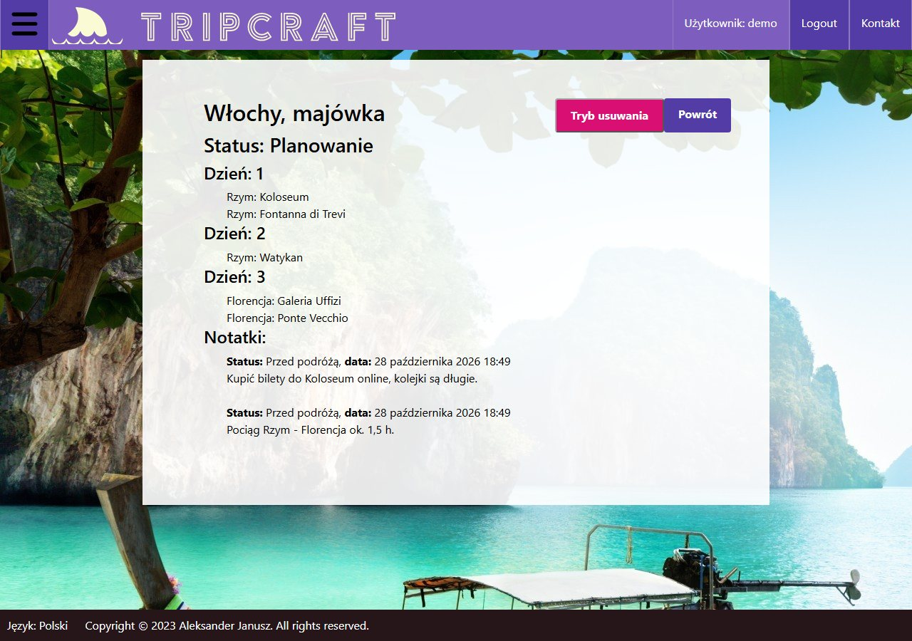
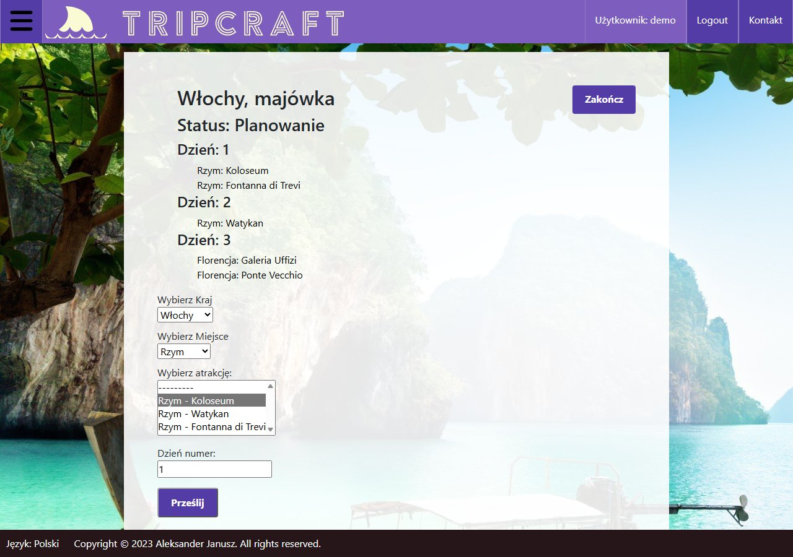

# TripCraft: Django trip planner

My first solo Django app, built in 2023 during the Coders Lab Python bootcamp
and deployed on AWS (EC2 + RDS) at the time. The UI is in Polish.



## What it does

- **Accounts:** registration and login. Each user sees and edits only their own trips.
- **Places and attractions:** a catalogue of countries, cities and attractions with estimated costs.
- **Trip builder:** plan a trip day by day from attractions. Dependent selects
  (country → city → attraction) are filled from JSON endpoints with plain JavaScript (`fetch`).
- **Trip status and notes:** planning, on the road, finished. Notes are tied to the trip stage
  and marked when edited.
- **REST API:** a Django REST Framework endpoint for updating a trip's status.



## Tech stack

Python 3.11 · Django 4.2 · Django REST Framework · PostgreSQL · JavaScript · HTML/CSS ·
pytest + pytest-django (71 tests)

## Running locally

```bash
# PostgreSQL, e.g. in Docker
docker run -d --name trip-maker-db -e POSTGRES_PASSWORD=postgres \
  -e POSTGRES_DB=trip_maker -p 5432:5432 postgres:15

python -m venv .venv
source .venv/bin/activate          # Windows: .venv\Scripts\activate
pip install -r requirements.txt

export POSTGRES_PASSWORD=postgres  # all variables: .env.example
python manage.py migrate
python manage.py runserver
```

The app runs at http://127.0.0.1:8000.

## Tests

```bash
pytest
```

## Note

Refreshed in 2026: configuration moved to environment variables and test discovery fixed.
The application code is kept as it was in 2023.
